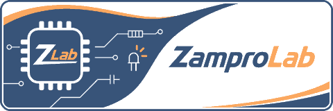

# ZamproLab




ZamproLab is an embedded learning environment for ESP32. Its browser-based LAB lets you manage UserFS files, edit and save Lua programs, request RUN and STOP, and view their output. Samples are included in the read-only WebFS and must be copied to UserFS before they can run.

## Features and hardware

The firmware uses ESP-IDF, FreeRTOS and Lua 5.5.1. It provides a serial administrative console, Wi-Fi AP/STA/AP+STA, a local HTTP server, a File Manager, a Program Manager, and Lua digital GPIO and I²C bindings. The Samples include an I²C scanner. Optional BME280 and SSD1306 libraries and dependent Samples are omitted from this source distribution. Output is delivered by HTTP polling; WebSocket is not used.

ESP32 Classic and one ESP32-S3-N16R8 have been tested on hardware; the generic ESP32-S3 profile has been built but not separately hardware-validated. The verified S3 has 16 MB flash, 8 MiB physical Octal PSRAM (enabled only by the explicit PSRAM profile), and an optional GPIO48 RGB indicator; that LED profile is specific to the verified board. The shared partition layout occupies the first 4 MiB. External S3 GPIO and I²C peripherals have not been physically validated. See the [hardware matrix](docs/hardware.md) before selecting a board, profile or pins.

**Security:** HTTP has neither authentication nor TLS. Anyone with network access can read or change UserFS files and run saved programs. Use a trusted local network and never expose the LAB directly to the Internet. The initial AP password is intended for teaching and must be changed through the administrative console. Lua is not a complete sandbox.

This source distribution includes no precompiled firmware. Obtain build dependencies separately and install any compatible peripheral libraries yourself. Users are responsible for checking third-party library compatibility and license terms.

## Requirements and build

Use ESP-IDF 5.5.3, the associated toolchains, CMake, Ninja and Python. Initial dependency acquisition requires network access. Install and activate ESP-IDF using the [Espressif guide](https://docs.espressif.com/projects/esp-idf/en/v5.5.3/esp32/get-started/). Then clone this distribution repository and enter it:

```sh
git clone https://github.com/zampro79/ZamproLab.git
cd ZamproLab
```

From the project root with ESP-IDF active:

```sh
python3 tools/prepare_lua.py
export LUA_DIR="$PWD/.deps/lua-5.5.1"
idf.py -B build-esp32 -D SDKCONFIG=sdkconfig.esp32 set-target esp32 build
idf.py -B build-esp32s3 -D SDKCONFIG=sdkconfig.esp32s3 set-target esp32s3 build
```

Lua is enabled by default. Use a separate build directory and `-D ZAM_EXPERIMENTAL_LUA=OFF` for a diagnostic build without Lua. See [build and dependencies](docs/build-reproducibility.md) for reproducibility and offline limitations.

For the explicitly validated S3-N16R8 RGB board with octal PSRAM, use the separate build command in [PSRAM configuration](docs/psram-lua.md#configuration); a generic S3 build does not enable that profile. Generate the separate LittleFS images after the LittleFS component has been acquired:

```sh
./tools/build_storage_images.sh build-storage-images
```

This creates WebFS and an **empty** UserFS image locally. Never write the empty image over data to preserve. The packager also accepts a Gitless source snapshot with `SOURCE_SNAPSHOT.json`. Set `LUA_DIR` to verified Lua 5.5.1 sources outside the snapshot and prevent Python caches inside it; see [source snapshots](docs/source-provenance.md#source-snapshots-and-packaging).

## Flashing and first connection

Before writing, identify the board, check its partition table and installed bootloader compatibility with the candidate Factory, and back up every region that may be overwritten. Stop if compatibility is uncertain. Flashing a partition table, an empty UserFS image, or other regions can destroy UserFS or NVS data. Do not use `erase-flash` as a routine step. Initial provisioning and WebFS installation require the separate procedure in [storage](docs/storage.md); application flashing alone does not install WebFS.

For a previously provisioned and verified ESP32 Classic, select the actual serial port and flash only the application:

```sh
idf.py -B build-esp32 -D SDKCONFIG=sdkconfig.esp32 -p /dev/ttyUSB0 app-flash monitor
```

Exit the monitor with `Ctrl+]`. Use the corresponding target, configuration and UART0 port for S3. On a new installation without STA credentials, look for `ZamproLab-XXXXXX` (the suffix uses the final three base MAC bytes), connect using the educational initial AP password `ZamproLab`, and open `http://192.168.4.1/` on a trusted network. Change the AP password via the serial console. Existing NVS settings may instead select a different AP name, password or Wi-Fi mode. On STA use the address reported by `wifi status`; if Wi-Fi is unavailable, connect UART0 at 115200 baud and check boot messages and `wifi status`. See [Wi-Fi](docs/wifi.md), [Web Settings](docs/wifi-web-settings.md), [console](docs/console.md), and [HTTP](docs/http.md).

## Using the LAB

Open or create a text file in UserFS, edit it, save it, and select RUN. The Terminal shows program output; STOP requests cooperative termination. To use an example, open **Explorer → Samples**, select a sample, copy it to the current UserFS directory, open and inspect the copy, then select RUN. STOP can be used where needed. Samples are not executed directly from WebFS. For a first test choose `01_hello.lua`: after RUN the Terminal should show `Hello from ZamproLab!` and the program finishes on its own. Use `02_countdown.lua` to try cooperative STOP; check the Execution status and Terminal for errors.

The Program Manager accepts one active execution at a time. Lua uses a 49,152-byte (48 KiB) internal allocation limit on Classic and generic S3. The explicit verified S3-N16R8 PSRAM profile uses a 262,144-byte limit in PSRAM; it is a dynamic allocation ceiling, not a preallocated pool. STOP is cooperative and is not guaranteed to interrupt every native call immediately. Cleanup releases resources on completion, STOP, errors and OOM where possible. See [Lua runtime](docs/lua-runtime.md), [Program API](docs/program-api.md), and [Terminal](docs/terminal-http.md).

Pure Lua modules in UserFS can be loaded with `require()`. The LAB offers **Import Library** and **Libraries**; regular file deletion requires an ETag and rejects stale versions. See [Lua modules](docs/lua-userfs-modules.md).

At boot, eligible UserFS scripts in `/autorun` run sequentially. The Execution panel can copy an Autorun script and requests confirmation for replacement or removal. A faulty boot script can prevent browser access; STOP is cooperative and no persistent recovery latch exists. See [Autorun](docs/autorun-core.md).

The editor shows line numbers and a one-based `Ln X, Col Y` caret indicator. The portable Welcome Sample prints on Classic and also animates the LED when the optional RGB API is available. The verified S3 uses green for READY, blue for RUNNING and red for ERROR; see [RGB and Lua](docs/lua-runtime.md#rgb-indicator-on-the-verified-s3-board) and [editor behavior](docs/web-ui.md).

## GPIO, I²C and peripherals

Digital `zam.gpio` input and output, allowed pins, cleanup and electrical precautions are described in [GPIO](docs/lua-gpio.md). Check the actual board and external circuit; firmware allowlists do not establish electrical safety. I²C supports 100 and 400 kHz transfers of up to 256 bytes; `scan()` is supported at 100 kHz only. See [I²C](docs/lua-i2c.md).

The tested Classic setup used BME280 at `0x76` and an SSD1306 128×32 at `0x3C`, with suitable 3.3 V pull-ups. The earlier optional driver also supported SSD1306 128×64, which was not physically validated in that campaign. The BME280 and SSD1306 modules and dependent Samples are omitted from this source distribution; general I²C and GPIO APIs remain available.

## Documentation

The owner selected [MIT](LICENSE) for original ZamproLab material, including original frontend, scripts, samples and documentation. This does not change the terms of third-party or adapted material; provenance of adapted fragments still requires review. Precompiled Factory redistribution remains suspended pending Xtensa HAL clarification. Third-party components retain their own licenses; see [notices](THIRD_PARTY_NOTICES.md). The optional SSD1306 library and its Spleen glyphs are not included in this source distribution.

- [Architecture](docs/architecture.md), [Web UI](docs/web-ui.md), [file API](docs/files.md), [output design](docs/output-stream-design.md)
- [Storage and partitions](docs/storage.md), [build reproducibility](docs/build-reproducibility.md), [security and runtime limits](docs/lua-runtime.md)
- [Hardware and validation matrix](docs/hardware.md), [distribution and licensing proposal](docs/distribution-proposal.md)
- Historical resource studies: 12A (historical document omitted from this snapshot), 12B (historical document omitted from this snapshot), 12C (historical document omitted from this snapshot), 12D (historical document omitted from this snapshot). The Classic and generic S3 48 KiB limit remains unchanged; the verified S3 PSRAM profile has a separate 256 KiB limit. The OLED prototype and forced-GC experiment were not adopted.
